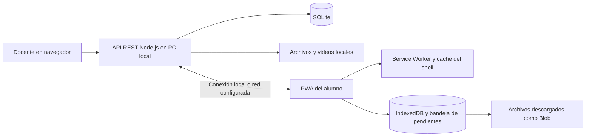

# AulaRaíz propuesta de proyecto y alineación con PA1 y PA2

Autor de la propuesta: Roberto Alejandro Cardenas Curisinche. Grupo D, cuatro integrantes. Fecha: 4 de noviembre de 2026.

AulaRaíz aborda el acceso a contenidos educativos cuando la cobertura es intermitente. La solución propuesta es una aplicación web instalable o PWA con servidor local, descarga de materiales y cuestionarios, conservación de respuestas en el dispositivo y sincronización posterior. Este documento define el alcance, el backlog y la validación que el equipo debe trasladar a sus entregables académicos. Las metas, estimaciones, roles y sprints son una propuesta para acordar; no son resultados medidos ni acuerdos atribuidos a los compañeros.

## 1 Problemática y objetivos

### Problema

Los alumnos con conectividad intermitente no pueden mantener una sesión de estudio cuando los materiales, videos o cuestionarios dependen de una conexión permanente. Los docentes tampoco disponen de avances completos si las respuestas se pierden o quedan únicamente en el dispositivo. Se necesita permitir la preparación de contenidos con conexión y el estudio autónomo sin conexión, conservando evidencias hasta que puedan enviarse al servidor.

No se dispone todavía de una encuesta, cifra de cobertura ni tamaño de población validado. El equipo debe describir la institución y población reales con datos de su investigación, sin presentar los ejemplos de la aplicación como evidencia de campo.

| Causa | Consecuencia que el proyecto busca reducir |
| --- | --- |
| Cobertura móvil inestable o acceso limitado a la red | Interrupción del estudio y de la entrega de actividades |
| Plataformas que consultan continuamente al servidor | Imposibilidad de abrir contenidos o cuestionarios sin conexión |
| Falta de almacenamiento local y control de reintentos | Pérdida de respuestas o duplicados al restablecerse la conexión |
| Archivos grandes sin descarga planificada | Consumo de datos y dificultad para reproducir videos |

### Objetivo general

Desarrollar una aplicación web progresiva de apoyo educativo para docentes y alumnos con conectividad intermitente, que permita publicar y descargar materiales, videos y cuestionarios, estudiar y resolver actividades sin conexión y sincronizar respuestas y avances al recuperar acceso al servidor, para dar continuidad al aprendizaje y reducir la pérdida de trabajo durante el periodo de validación académica del proyecto.

Indicadores propuestos del objetivo general:

1. Continuidad sin conexión = recorridos de estudio y cuestionario completados con contenidos previamente descargados / recorridos previstos × 100. Meta propuesta: 100 % de los recorridos críticos del PMV aprobados en el entorno de calidad antes de la exposición.
2. Conservación y sincronización = intentos pendientes recibidos exactamente una vez en el servidor / intentos generados en los escenarios de prueba × 100. Meta propuesta: 100 % después de reconectar, incluso en el caso de un reintento tras una respuesta de red perdida.

### Objetivos específicos

1. Al finalizar el sprint 1, definir y validar con los cuatro integrantes tres épicas, quince historias y su prioridad para mantener un alcance compartido. Indicador: historias revisadas con cuatro tareas y dos criterios / 15 × 100; meta propuesta 100 %.
2. Al finalizar el sprint 2, habilitar la descarga y reapertura de una unidad educativa con material, video de prueba y cuestionario en un navegador compatible. Indicador: tipos de recurso disponibles al recargar sin conexión / 3 × 100; meta propuesta 100 %.
3. Al finalizar el sprint 3, conservar intentos pendientes y enviarlos con identificadores estables, sin duplicar registros tras reintentar. Indicador: escenarios críticos de sincronización aprobados / escenarios críticos ejecutados × 100; meta propuesta 100 %.
4. Antes de la exposición, ejecutar las pruebas del PMV y documentar evidencias, incidencias y correcciones. Indicador: historias del PMV con al menos una evidencia reproducible / historias del PMV × 100; meta propuesta 100 %. Una evidencia fallida no se contabiliza como aprobada.

Los sprints representan una secuencia propuesta. El equipo debe fijar su duración y fechas reales en Trello; no se asignan fechas de entrega del curso que no aparecen en los archivos proporcionados.

### Alcance

Incluye acceso por roles docente y alumno; catálogo de cursos y unidades; publicación de materiales, archivos de video y cuestionarios de alternativa múltiple; descarga explícita; apertura de recursos descargados sin conexión; respuestas y avance locales; bandeja de pendientes; reintento de sincronización; confirmación y calificación en servidor; consulta del docente; actualización de versiones descargadas; e instalación PWA en dispositivos compatibles.

Quedan fuera del PMV: videollamadas, streaming sin descarga, integración con sistemas institucionales, pagos, tiendas de aplicaciones, generación de APK o instalador nativo, supervisión de exámenes, certificación de identidad, analítica predictiva, uso multiinstitución y servicio público permanente con soporte institucional. El acceso offline no convierte en disponible un contenido que nunca se descargó.

Restricciones: espacio y permisos del navegador; necesidad de una primera carga y descarga; compatibilidad de reproducción del video; límites de subida y almacenamiento definidos por el servidor; disponibilidad del PC que ejecuta la API; y contexto seguro para instalar y ejecutar el Service Worker. La prueba en un celular real requiere configuración y evidencia específica.

Supuestos por validar: los alumnos pueden conectarse periódicamente al servidor, cuentan con almacenamiento suficiente y utilizan un navegador compatible; los docentes tienen autorización para distribuir los materiales; y el grupo dispone de una computadora para servir el proyecto durante las pruebas. Recuperar internet no es suficiente si el servidor local continúa inaccesible.

## 2 Requisitos y organización

### Requisitos del sistema

Solicitante de los requisitos: grupo de proyecto a partir de la necesidad educativa descrita en la conversación del 4 de noviembre de 2026. Los roles docente y alumno son usuarios previstos y todavía deben validarse con personas de la población objetivo.

| ID | Tipo | Nombre y descripción | Historia |
| --- | --- | --- | --- |
| RQ01 | RF | Identificar al usuario y aplicar permisos de docente o alumno | HU01 |
| RQ02 | RF | Consultar cursos y unidades disponibles | HU02 |
| RQ03 | RF | Publicar materiales educativos desde el perfil docente | HU03 |
| RQ04 | RF | Publicar un archivo de video descargable | HU04 |
| RQ05 | RF | Publicar cuestionarios de alternativa múltiple | HU05 |
| RQ06 | RF | Descargar y conservar una unidad para uso local | HU06 |
| RQ07 | RF | Abrir material y video descargados sin conexión | HU07 |
| RQ08 | RF | Resolver y conservar un cuestionario sin conexión | HU08 |
| RQ09 | RF | Registrar y consultar el avance local | HU09 |
| RQ10 | RF | Sincronizar pendientes con confirmación e idempotencia | HU10 |
| RQ11 | RF | Detectar y descargar nuevas versiones sin destruir pendientes | HU11 |
| RQ12 | RF | Mostrar al docente respuestas sincronizadas y resultados | HU12 |
| RQ13 | RNF | Proteger operaciones y registros mediante permisos por rol | HU13 |
| RQ14 | RNF | Permitir uso adaptable y accesible con etiquetas y teclado | HU14 |
| RQ15 | RNF | Mantener datos locales ante fallos de red y dar respuesta visible | HU15 |

### Organización propuesta para cuatro integrantes

La plantilla de Grupo D no contiene nombres del docente ni de otros integrantes. Los siguientes puestos deben completarse con los nombres y acuerdos reales. Un equipo de cuatro personas puede distribuir varias responsabilidades en una misma persona; no implica contratar seis personas por las seis especialidades del formato.

| Persona | Responsabilidades propuestas | Entregable principal |
| --- | --- | --- |
| Roberto Alejandro Cardenas Curisinche | Desarrollo de la PWA y API, arquitectura, integración y guía de ejecución | Aplicación y evidencias técnicas |
| Integrante 2 por completar | Product Owner, problema, objetivos, alcance y priorización con el grupo | PA1 y validación de requisitos |
| Integrante 3 por completar | Scrum Master, coordinación, tablero, seguimiento y consolidación del informe | Backlog y avance del equipo |
| Integrante 4 por completar | Calidad, casos de prueba, ejecución y evidencias; apoyo en datos y presentación | Plan de pruebas y evidencias del PA2 |

Organigrama funcional propuesto: grupo y usuarios previstos → Product Owner para prioridades; Scrum Master para facilitar el proceso; equipo de desarrollo formado por los cuatro integrantes para producir y validar el incremento. Los roles de frontend, backend y calidad son responsabilidades técnicas dentro del equipo, no niveles jerárquicos de Scrum.

Acuerdos a confirmar: una tarjeta por historia en Trello, identificador HU estable, tareas con responsable, registro de impedimentos y revisión del incremento al cierre de cada sprint. Una historia se considera terminada cuando cumple sus criterios, supera sus pruebas aplicables y tiene evidencia revisable. No se debe declarar terminada una funcionalidad solo porque aparece dibujada en la interfaz.

## 3 Épicas

Las estimaciones son puntos de historia relativos propuestos, no horas de trabajo. Su suma sirve únicamente como referencia inicial; debe revisarse con el equipo.

| Épica | Propósito | Rol principal | Valor | Criterio general de aceptación | Estimación inicial |
| --- | --- | --- | --- | --- | --- |
| E01 Publicación educativa | Gestionar el acceso y preparar contenidos de cursos | Docente y alumno | Disponer de material organizado para estudiar | El docente publica recursos y cuestionarios; el alumno consulta los cursos autorizados | 21 puntos, HU01–HU05 |
| E02 Aprendizaje sin conexión | Descargar recursos y conservar el trabajo local | Alumno | Continuar el estudio sin red | Una unidad descargada puede reabrirse y responderse offline después de recargar | 21 puntos, HU06–HU09 |
| E03 Sincronización y calidad | Consolidar avances y garantizar acceso confiable | Alumno y docente | Recuperar evidencias sin duplicados y usar la app con claridad | Los pendientes se confirman en servidor; se validan permisos, interfaz y recuperación | 34 puntos, HU10–HU15 |

## 4 Historias y backlog

Las quince historias siguientes contienen sesenta tareas y treinta criterios de aceptación. HU13, HU14 y HU15 representan requisitos no funcionales. Todas se consideran parte del PMV propuesto porque cubren el recorrido educativo básico y sus condiciones mínimas de calidad; no todas están necesariamente implementadas o validadas en la primera entrega local.

Prioridad P1 significa necesaria para el recorrido crítico; P2, necesaria para completar la calidad del PMV. Release 1 corresponde a la versión académica a validar. Cada historia debe verificarse contra la aplicación y sus evidencias antes de cambiar su estado a terminada.

### HU01 Acceso por rol

E01 · RF · P1 · Sprint 1 · Release 1 · 5 puntos · Owner propuesto Roberto.

Como usuario, quiero identificarme con un perfil de docente o alumno para acceder a las funciones correspondientes.

Tareas: 1) Definir usuarios y roles de prueba. 2) Implementar validación de credenciales en la API. 3) Conectar formulario y sesión a la interfaz. 4) Verificar acceso correcto y rechazo de credenciales inválidas.

- Dado que tengo credenciales válidas, cuando inicio sesión, entonces veo el perfil y las funciones de mi rol.
- Dado que las credenciales son inválidas, cuando intento acceder, entonces la API rechaza el acceso y la interfaz muestra un mensaje sin abrir una sesión.

### HU02 Catálogo de cursos

E01 · RF · P1 · Sprint 1 · Release 1 · 3 puntos · Owner propuesto Roberto.

Como alumno, quiero consultar los cursos y sus unidades para elegir qué contenidos estudiar y descargar.

Tareas: 1) Definir la estructura de curso y unidad. 2) Implementar la consulta del catálogo. 3) Diseñar tarjetas y navegación. 4) Verificar estados con datos y sin contenidos disponibles.

- Dado que el servidor está disponible, cuando abro el catálogo, entonces veo los cursos y unidades publicados.
- Dado que una unidad no está descargada y no hay conexión al servidor, cuando intento abrir sus recursos, entonces se informa que requieren descarga previa.

### HU03 Publicación de materiales

E01 · RF · P1 · Sprint 1 · Release 1 · 5 puntos · Owner propuesto Roberto.

Como docente, quiero publicar materiales de una unidad para que mis alumnos puedan consultarlos y descargarlos.

Tareas: 1) Definir campos y validaciones del material. 2) Implementar persistencia y operación de publicación. 3) Crear el formulario docente. 4) Probar publicación válida y rechazo de datos incompletos.

- Dado que accedo como docente y completo los campos requeridos, cuando publico un material, entonces queda asociado a la unidad y disponible en el catálogo.
- Dado que falta un campo obligatorio, cuando intento publicar, entonces se muestra el error y no se crea un material incompleto.

### HU04 Publicación de videos

E01 · RF · P1 · Sprint 1 · Release 1 · 3 puntos · Owner propuesto Roberto.

Como docente, quiero asociar un archivo de video descargable a una unidad para que el alumno pueda reproducirlo después sin conexión.

Tareas: 1) Definir formatos y límite admitidos. 2) Implementar guardado del archivo en el servidor. 3) Agregar carga y reproductor accesible. 4) Probar un archivo admitido y uno rechazado.

- Dado que envío un video admitido dentro del límite configurado, cuando finaliza la publicación, entonces el recurso puede descargarse y reproducirse.
- Dado que el archivo excede el límite o no tiene un formato admitido, cuando intento publicarlo, entonces se rechaza con un mensaje y no queda una publicación válida engañosa.

### HU05 Cuestionarios del docente

E01 · RF · P1 · Sprint 1 · Release 1 · 5 puntos · Owner propuesto Roberto.

Como docente, quiero publicar preguntas con alternativas y respuesta correcta para evaluar el aprendizaje de la unidad.

Tareas: 1) Definir preguntas y alternativas. 2) Implementar almacenamiento de la clave en servidor. 3) Crear el editor del cuestionario. 4) Comprobar publicación y exclusión de la clave en las respuestas de la API al alumno.

- Dado que un cuestionario contiene preguntas válidas y sus claves, cuando el docente lo publica, entonces aparece disponible para el alumno.
- Dado que accedo como alumno, cuando descargo el cuestionario, entonces recibo las preguntas y alternativas sin la clave de corrección del servidor.

### HU06 Descarga de una unidad

E02 · RF · P1 · Sprint 2 · Release 1 · 8 puntos · Owner propuesto Roberto.

Como alumno, quiero descargar una unidad completa para disponer de sus contenidos y cuestionario cuando no tenga conexión.

Tareas: 1) Definir el paquete local y su versión. 2) Guardar datos en IndexedDB y recursos en almacenamiento local. 3) Mostrar progreso y confirmación de descarga. 4) Probar una descarga completa y otra interrumpida.

- Dado que tengo conexión al servidor y espacio suficiente, cuando descargo una unidad, entonces solo se marca lista después de almacenar todos sus recursos requeridos.
- Dado que la descarga falla o falta espacio, cuando termina el intento, entonces se informa el fallo y la unidad no se marca como completamente disponible sin conexión.

### HU07 Consulta offline de recursos

E02 · RF · P1 · Sprint 2 · Release 1 · 5 puntos · Owner propuesto Roberto.

Como alumno, quiero abrir los materiales y videos ya descargados sin conexión para continuar estudiando.

Tareas: 1) Configurar la caché del shell con Service Worker. 2) Resolver recursos desde la copia local. 3) Mostrar el estado de disponibilidad. 4) Verificar material y video tras recargar con red desactivada.

- Dado que descargué correctamente la unidad, cuando desactivo la red y recargo la aplicación, entonces puedo abrir el material local y reproducir el video descargado compatible.
- Dado que el recurso no se descargó, cuando intento abrirlo sin conexión, entonces se informa la limitación sin simular una descarga exitosa.

### HU08 Resolución offline de cuestionarios

E02 · RF · P1 · Sprint 2 · Release 1 · 5 puntos · Owner propuesto Roberto.

Como alumno, quiero responder un cuestionario descargado y guardar el intento sin conexión para enviarlo posteriormente.

Tareas: 1) Guardar selecciones locales del cuestionario. 2) Crear un identificador estable de intento. 3) Guardar el intento en la bandeja de pendientes. 4) Verificar persistencia tras recargar y ausencia de calificación final inventada.

- Dado que el cuestionario está descargado y no hay conexión, cuando termino y guardo mis respuestas, entonces el intento aparece pendiente con su identificador y versión.
- Dado que guardé un intento pendiente, cuando cierro y vuelvo a abrir la aplicación, entonces las respuestas continúan disponibles y la calificación del servidor sigue pendiente.

### HU09 Avance local

E02 · RF · P1 · Sprint 2 · Release 1 · 3 puntos · Owner propuesto Roberto.

Como alumno, quiero conservar qué materiales he completado para retomar mi estudio y enviar después el avance.

Tareas: 1) Definir eventos de avance por alumno y recurso. 2) Persistir los cambios localmente. 3) Mostrar avance y estado pendiente. 4) Comprobar conservación y separación entre perfiles.

- Dado que consulto una unidad descargada, cuando marco un recurso como completado sin conexión, entonces el avance se guarda localmente.
- Dado que existe avance pendiente, cuando recargo la aplicación con el mismo perfil, entonces veo el avance conservado y su estado de sincronización.

### HU10 Sincronización de pendientes

E03 · RF · P1 · Sprint 3 · Release 1 · 8 puntos · Owner propuesto Roberto.

Como alumno, quiero enviar mis respuestas y avances pendientes al recuperar acceso al servidor para registrar mi trabajo sin duplicarlo.

Tareas: 1) Implementar la bandeja de salida persistente. 2) Crear recepción idempotente y confirmación en API. 3) Activar reintentos automáticos con la app abierta y botón manual. 4) Probar caída antes y después de recibir el intento.

- Dado que tengo intentos pendientes y el servidor vuelve a estar disponible, cuando sincronizo con sesión válida, entonces recibo confirmación y los intentos pasan a sincronizados con el resultado del servidor.
- Dado que el servidor recibió un intento pero la respuesta se perdió, cuando reintento con el mismo identificador y contenido, entonces se conserva un único intento y se devuelve su confirmación previa.

### HU11 Actualización de contenidos

E03 · RF · P1 · Sprint 3 · Release 1 · 5 puntos · Owner propuesto Roberto.

Como alumno, quiero identificar y descargar nuevas versiones de las unidades para estudiar contenido actualizado sin perder mis respuestas pendientes.

Tareas: 1) Definir versiones inmutables por publicación. 2) Comparar catálogo remoto y copia descargada. 3) Incorporar actualización de la descarga. 4) Probar actualización con un intento de versión anterior pendiente.

- Dado que el docente publicó una nueva versión, cuando consulto actualizaciones con conexión, entonces la aplicación permite descargar el contenido actualizado.
- Dado que tengo un intento de una versión anterior pendiente, cuando actualizo y luego sincronizo, entonces el intento conserva su versión y el servidor lo procesa con la versión correspondiente.

### HU12 Consulta de resultados docentes

E03 · RF · P1 · Sprint 3 · Release 1 · 5 puntos · Owner propuesto Roberto.

Como docente, quiero consultar intentos y avances recibidos para revisar la participación y los resultados de los alumnos.

Tareas: 1) Definir consulta de respuestas recibidas. 2) Aplicar permisos del docente en la API. 3) Mostrar alumno, unidad, fecha y resultado. 4) Verificar que un intento local pendiente todavía no figura como recibido.

- Dado que un alumno sincronizó un intento, cuando el docente consulta resultados, entonces ve ese intento y su calificación registrada por el servidor.
- Dado que un alumno todavía tiene un intento solo local, cuando el docente consulta el servidor, entonces ese intento no se presenta como recibido.

### HU13 Seguridad por rol

E03 · RNF · P1 · Sprint 4 · Release 1 · 5 puntos · Owner propuesto integrante 4 con apoyo de Roberto.

Como responsable del proyecto, quiero proteger las operaciones y separar registros por perfil para evitar modificaciones y lecturas no autorizadas.

Tareas: 1) Identificar operaciones y datos protegidos. 2) Aplicar controles en servidor y consultas parametrizadas. 3) Evitar contraseñas en texto plano y exposición de claves de cuestionarios. 4) Ejecutar casos negativos de permisos y separación de usuarios.

- Dado que tengo una sesión de alumno, cuando llamo directamente a una operación de publicación docente, entonces el servidor rechaza la operación y no modifica el contenido.
- Dado que existen registros de otro alumno, cuando solicito sus registros mediante un identificador ajeno, entonces el servidor impide la lectura no autorizada.

### HU14 Interfaz adaptable y accesible

E03 · RNF · P2 · Sprint 4 · Release 1 · 3 puntos · Owner propuesto integrante 4 con apoyo de Roberto.

Como usuario de celular o computadora, quiero una interfaz adaptable con controles identificables y operables con teclado para completar las acciones esenciales.

Tareas: 1) Definir tamaños y navegación para pantallas pequeñas. 2) Etiquetar formularios y estados sin depender solo del color. 3) Asegurar foco visible y operación por teclado. 4) Revisar el recorrido a 360 px y 1280 px y documentar incidencias.

- Dado que uso una pantalla de 360 px de ancho, cuando completo el recorrido esencial, entonces no necesito desplazamiento horizontal para acceder a sus controles.
- Dado que navego con teclado, cuando paso por los controles de acceso, descarga y cuestionario, entonces el foco es visible y las acciones tienen un nombre identificable.

### HU15 Resiliencia y respuesta visible

E03 · RNF · P1 · Sprint 4 · Release 1 · 8 puntos · Owner propuesto integrante 4 con apoyo de Roberto.

Como alumno con red inestable, quiero conservar los datos ante fallos y entender el estado de cada operación para continuar sin perder trabajo.

Tareas: 1) Definir estados local, pendiente, sincronizando, error y confirmado. 2) Aplicar límites de espera y mensajes recuperables. 3) Proteger pendientes ante fallos y reintentos. 4) Medir apertura offline y ejecutar interrupciones repetidas con un conjunto documentado.

- Dado que el servidor deja de responder durante el envío, cuando vence el límite de espera, entonces el intento permanece pendiente y se ofrece reintentar sin borrar las respuestas.
- Dado que una unidad está descargada en el dispositivo de referencia, cuando la abro sin conexión, entonces el contenido de texto aparece en un máximo propuesto de 2 segundos en al menos 9 de 10 mediciones, registrando navegador, equipo y tamaño del conjunto probado.

### Resumen de priorización

| Sprint | Historias | Objetivo | Puntos propuestos |
| --- | --- | --- | --- |
| 1 | HU01–HU05 | Acceso y publicación | 21 |
| 2 | HU06–HU09 | Descargas y estudio offline | 21 |
| 3 | HU10–HU12 | Sincronización, versiones y consulta | 18 |
| 4 | HU13–HU15 | Validación de calidad y recuperación | 16 |
| Total | 15 historias | PMV Release 1 | 76 |

## 5 Diseño técnico y entornos

### Tecnologías elegidas

| Capa | Tecnología | Justificación |
| --- | --- | --- |
| Interfaz | HTML, CSS y JavaScript con módulos ES | Aplicación local sin compilación ni dependencia de una plataforma de conversación |
| Instalación y shell offline | Manifest de PWA y Service Worker | Permitir instalación en navegadores compatibles y reapertura del shell desde caché |
| Datos en dispositivo | IndexedDB | Conservar unidades, selecciones, avance e intentos pendientes entre recargas |
| Recursos locales | Archivos descargados como Blob en IndexedDB; Cache API para el shell | Abrir únicamente lo descargado sin solicitar continuamente al servidor |
| Servidor | Node.js con API REST | Ejecutar la aplicación y sincronizar desde el PC del equipo |
| Base de datos | SQLite mediante node:sqlite | Persistir registros sin instalar un servidor de base de datos separado |
| Archivos | Directorio de archivos del servidor local | Almacenar materiales y videos publicados, con rutas y validación controladas |
| Calidad | node:test, solicitudes HTTP, herramientas del navegador y k6 propuesto | Cubrir lógica, integración, recorridos y rendimiento |

Base de compatibilidad: Node.js 22.13 o posterior para utilizar node:sqlite sin bandera experimental de activación; conviene fijar y probar una versión LTS compatible. La API y sus pruebas deben validar la versión concreta utilizada. La disponibilidad del módulo no equivale por sí sola a estabilidad de todas sus funciones. [Documentación oficial de node:sqlite en Node 22.13.1](https://nodejs.org/download/release/v22.13.1/docs/api/sqlite.html).

### Arquitectura general

El docente publica en el servidor. El alumno descarga mientras tiene acceso a ese servidor y almacena una versión utilizable localmente. Las respuestas se guardan primero en el dispositivo. La calificación final se genera en el servidor cuando recibe el intento; una pantalla sin conexión no debe anunciar una recepción que todavía no ha ocurrido.

El flujo que la plantilla denomina docente–nube–estudiante se adapta aquí a docente–servidor local–estudiante. No se requiere contratar nube para la demostración local. Si posteriormente se necesita conexión entre alumnos ubicados fuera de la red del PC, habrá que acordar alojamiento o conectividad adicional y actualizar el informe.

### Modelo lógico y correspondencia con el código

El esquema implementado se encuentra en `server/index.mjs`. En esta versión, la interfaz llama unidad al conjunto descargable de un curso. No existe una tabla independiente de unidades ni de matrícula. Varios atributos se almacenan como JSON en la columna `data`; no deben dibujarse en el informe como tablas normalizadas que todavía no existen.

| Tabla SQLite real | Clave y campos | Relaciones y función |
| --- | --- | --- |
| users | `id` PK; `name`, `email` UNIQUE, `role`, `password_hash` | Roles `student` y `teacher`; genera sesiones, intentos, avances y recibos |
| sessions | `token_hash` PK; `user_id`, `expires_at` | `user_id` FK a users; guarda hash SHA256 del token y vencimiento |
| courses | `id` PK; `data` JSON | Catálogo; courses 1:N materials y courses 1:N quizzes |
| materials | `id` PK; `course_id`, `version`, `data` JSON | `course_id` FK a courses; conserva la versión actual de lectura, archivo o video |
| quizzes | `id` PK; `course_id`, `version` | `course_id` FK a courses; indica la versión vigente del cuestionario |
| quiz_versions | PK compuesta `quiz_id, version`; `data` JSON | `quiz_id` FK a quizzes; conserva preguntas, alternativas y clave por versión |
| attempts | `id` PK; `user_id`, `quiz_id`, `quiz_version`, `answers`, `result`, `submitted_at` | FK a users y FK compuesta a quiz_versions; conserva respuestas y calificación del servidor |
| progress | PK compuesta `user_id, material_id`; `course_id`, `completed`, `updated_at` | FK a users y materials; mantiene el estado actual de cada material para cada alumno |
| event_receipts | `id` PK; `user_id`, `payload_hash`, `result`, `received_at` | `user_id` FK a users; recibo idempotente para eventos de intento o avance |

Las preguntas y alternativas se incluyen en el JSON de `quiz_versions`. La clave `correctIndex` se excluye del catálogo que recibe el alumno. Un intento referencia explícitamente la versión respondida, que puede seguir corrigiéndose aunque exista una publicación posterior. Los materiales aumentan su número de versión cuando se editan, pero no cuentan con una tabla histórica equivalente a `quiz_versions`.

Los archivos publicados se guardan en `data/uploads`, y su ruta, nombre, MIME y tamaño se incluyen en el JSON del material. La API acepta PDF, TXT, PNG, JPG y videos MP4/WebM, con límite de 20 MB por archivo. La semilla contiene tres cursos, seis lecturas y tres cuestionarios, además de dos cuentas de demostración; no incluye videos. Para demostrar reproducción offline de video debe publicarse y descargarse un archivo real compatible.

La base del navegador se llama `aularaiz-local-v1` y contiene los siguientes almacenes de objetos, definidos en `public/db.js`:

| Almacén IndexedDB | Clave utilizada | Contenido |
| --- | --- | --- |
| kv | Prefijo `usuarioId:` para snapshot y última sincronización | Catálogo y registros del usuario recibidos del servidor; fecha de última sincronización |
| downloads | `usuarioId:cursoId` | Curso, materiales, cuestionarios, Blob de archivos, bytes y fecha de descarga |
| outbox | `usuarioId:eventoId` | Evento con ID estable, tipo, carga, fecha, usuario y error si corresponde |
| drafts | `usuarioId:quizId:version` | Alternativas seleccionadas antes de terminar el intento |

La sesión persistida para reabrir el perfil se guarda en localStorage como `aularaiz-session`. El Service Worker conserva el shell en la caché `aularaiz-shell-v1`; no intercepta las rutas `/api/`. Los materiales y videos descargados se recuperan desde los Blob de IndexedDB y se abren mediante URL de objeto local.

SQLite y los archivos del servidor constituyen la persistencia compartida. IndexedDB y la caché del navegador son una copia operativa local; no sustituyen el respaldo del servidor. Borrar datos del sitio, usar modo privado o perder el dispositivo puede eliminar contenido y pendientes locales.

### Sincronización y conflictos

1. Guardar respuestas y avance localmente antes de iniciar la red.
2. Crear una operación con identificador estable, usuario y versión del contenido.
3. Enviar con una sesión válida cuando el servidor sea accesible. El indicador de red del sistema no garantiza que la API responda.
4. Validar permisos y contenido en el servidor. Registrar el identificador de forma única antes de confirmar.
5. Marcar sincronizado únicamente al recibir una confirmación correspondiente a esa operación. Si la respuesta se pierde, reenviar el mismo identificador y carga.
6. Conservar el pendiente si hay error, sesión vencida o respuesta inválida. Presentar el motivo y permitir reintento.
7. Mantener versiones de cuestionarios para corregir intentos pendientes de versiones anteriores. La actualización de un material no debe reescribir silenciosamente el contexto de un intento ya terminado.

El reintento previsto funciona con la aplicación abierta, al recuperar acceso al servidor o por acción manual. No se promete sincronización automática con la app cerrada, pues depende de capacidades y políticas del navegador.

### Configuración de entornos

| Aspecto | Desarrollo | Calidad | Producción propuesta |
| --- | --- | --- | --- |
| Objetivo | Programar y depurar localmente | Verificar un incremento reproducible | Atender usuarios autorizados con configuración revisada |
| Datos | Ejemplos ficticios | SQLite y archivos separados del desarrollo | Datos reales solo con autorización y respaldo |
| Acceso | localhost en PC del desarrollador | localhost y HTTPS de red local para prueba física | HTTPS con certificado confiable y dirección estable |
| Credenciales | Cuentas de demostración identificadas | Cuentas y roles de prueba | Credenciales propias; retirar contraseñas de demostración |
| Archivos | Muestras pequeñas autorizadas | Casos válidos, límites y errores | Límites y capacidad monitoreados |
| Pruebas | node:test y depuración | Integración, offline, instalación y carga controlada | Comprobación de salud tras cambios y restauración probada |
| Evidencia | Cambios y registros técnicos | Resultados, equipo, navegador y capturas | Disponibilidad, fallos y registros de acceso pertinentes |

La versión académica local no constituye por sí sola un entorno de producción validado. Deben existir separación de datos, control de permisos, respaldo y restauración antes de usarla con alumnos reales.

### Instalación local

En PC, acceder a la dirección que indique el iniciador del proyecto, prevista como `http://localhost:4173`, y usar la opción de instalación del navegador compatible. No abrir `index.html` directamente con `file://` como sustituto del servidor. Para móvil, `localhost` representa al propio celular: se necesita la dirección del servidor en la red local, HTTPS y un certificado confiable para ese dispositivo. La primera carga y la descarga deben completarse con conexión antes de la prueba en modo avión. [Condiciones de instalación PWA en MDN](https://developer.mozilla.org/en-US/docs/Web/Progressive_web_apps/Guides/Making_PWAs_installable).

La caché del shell debe prepararse durante la instalación del Service Worker, y los datos que necesiten sobrevivir a su terminación deben persistirse en almacenamiento del navegador. [Service Worker API de MDN](https://developer.mozilla.org/en-US/docs/Web/API/Service_Worker_API), [guía de Service Workers de web.dev](https://web.dev/learn/pwa/service-workers).

## 6 Métricas del proyecto

Las siguientes son fichas de medición propuestas. No se dispone todavía de una línea base ni de resultados de campo; los umbrales iniciales deben revisarse según los dispositivos, el tamaño de datos y el calendario acordados.

| Nombre | Objetivo | Fórmula | Unidad y frecuencia | Fuente | Umbral inicial | Interpretación | Responsable propuesto |
| --- | --- | --- | --- | --- | --- | --- | --- |
| Velocidad por sprint | Estimar capacidad futura | Suma de puntos de HU aceptadas en el sprint | Puntos por sprint, al cierre | Trello y revisión del incremento | Sin meta fija antes de al menos dos sprints | Sirve para planificar al equipo, no para comparar personas | Scrum Master |
| Trabajo pendiente | Hacer visible el avance del sprint | Puntos comprometidos menos puntos aceptados | Puntos, diariamente | Backlog del sprint | Tendencia decreciente; revisar bloqueo de más de dos días hábiles | Un tramo plano puede indicar trabajo en curso o impedimentos | Scrum Master |
| Tiempo de ciclo | Detectar demoras desde inicio hasta aceptación | Fecha de aceptación menos fecha de inicio de cada HU; mediana del conjunto | Días por historia, al cierre | Historial del tablero | Revisar historias que excedan la duración de un sprint | Un ciclo alto requiere revisar tamaño, dependencias o validación | Equipo |
| Éxito de sincronización | Verificar recuperación de pendientes | Operaciones confirmadas / operaciones válidas pendientes del conjunto × 100 | Porcentaje, por corrida de prueba | IndexedDB, API y SQLite | 100 % en escenarios críticos del PMV tras recuperar servidor | Un valor menor implica operaciones sin confirmar; revisar el fallo antes de declarar éxito | Calidad |
| Duplicados de intento | Verificar idempotencia | Registros adicionales para un mismo id estable | Conteo, por corrida de reintentos | Consulta a SQLite y registro de prueba | 0 | Cualquier duplicado viola el criterio del PMV | Roberto y calidad |
| Aprobación de pruebas | Evaluar preparación del incremento | Casos aprobados / casos ejecutados × 100, con pendientes separados | Porcentaje, al cierre | Informe de pruebas | 100 % de casos críticos y 0 defectos críticos abiertos | No se incluyen como aprobados los casos omitidos o pendientes | Calidad |

## 7 PMV y pruebas

### Recorrido mínimo que se demostrará

Docente inicia sesión y publica una unidad con material, video y cuestionario. Alumno entra con conexión, descarga la unidad, espera la confirmación y permite completar la preparación offline. Se desactiva la red, se recarga la aplicación, se abre el material y video descargado y se responde el cuestionario. El intento permanece pendiente después de recargar. Al recuperar acceso al servidor, se sincroniza y se obtiene confirmación y calificación; un reintento no duplica el registro. El docente consulta el resultado recibido. Se valida además que un alumno no puede publicar y que una actualización conserva la versión del intento anterior.

### Cuatro tipos de pruebas

| Tipo | Qué comprueba | Herramienta | Ejemplo y evidencia |
| --- | --- | --- | --- |
| Unitarias | Lógica aislada de validación, cálculo y estados | node:test y node:assert | Respuestas válidas e inválidas; resultado esperado y salida del ejecutor |
| Integración | Colaboración API, permisos, SQLite y archivos | node:test con fetch y base temporal | Publicar, descargar, sincronizar y repetir id; estado HTTP y consulta del registro único |
| Funcionales de extremo a extremo y aceptación | Recorrido real en navegador, instalación y offline | Chrome o Edge DevTools, modo Offline y lista de pasos manuales; automatización futura si el equipo la incorpora | Descarga completa, recarga offline, video, respuestas persistentes y reconexión; capturas y registro de versión del navegador |
| Rendimiento y estrés controlado | Tiempo de respuesta y comportamiento bajo carga | k6 propuesto para API y panel Performance del navegador | Carga escalonada sobre datos de prueba; percentiles, errores, CPU y tamaño de archivos; ejecutar antes de declarar resultados |

La revisión de seguridad por rol se incorpora a pruebas de integración y aceptación. Las comprobaciones de teclado y tamaños se incorporan al recorrido funcional. No se presenta k6 ni la automatización de navegador como ejecutados si solo están propuestos.

### Matriz de trazabilidad de pruebas

| HU | PMV | Prueba principal | Herramienta | Resultado esperado |
| --- | --- | --- | --- | --- |
| HU01 | Sí | Integración y aceptación | node:test, fetch y navegador | Acceso válido, rechazo inválido y rol correcto |
| HU02 | Sí | Integración y funcional | fetch y navegador | Cursos publicados visibles y estado vacío claro |
| HU03 | Sí | Integración | node:test y fetch | Publicación persistida; datos incompletos rechazados |
| HU04 | Sí | Integración y funcional | fetch y reproductor del navegador | Archivo admitido utilizable; exceso rechazado |
| HU05 | Sí | Unitaria e integración | node:test | Cuestionario válido sin clave filtrada al alumno |
| HU06 | Sí | Funcional y error de descarga | DevTools Network y Application | Solo descarga íntegra marcada como disponible |
| HU07 | Sí | Aceptación offline | DevTools Offline y modo avión físico | Recursos ya descargados disponibles tras recargar |
| HU08 | Sí | Funcional offline | DevTools Application e IndexedDB | Intento y respuestas pendientes conservados |
| HU09 | Sí | Funcional e integración | Navegador y consulta API | Avance conserva perfil y estado |
| HU10 | Sí | Integración y recuperación | node:test, fetch, DevTools | Confirmación tras reconectar y un registro por intento |
| HU11 | Sí | Integración y aceptación | node:test y navegador | Actualización sin perder contexto del intento antiguo |
| HU12 | Sí | Integración | fetch y vista docente | Solo trabajo recibido visible como recibido |
| HU13 | Sí | Integración de permisos | node:test y fetch | Operaciones y lecturas ajenas rechazadas |
| HU14 | Sí | Aceptación de interfaz | DevTools Responsive y teclado | Recorrido usable a 360 px y 1280 px; foco y nombres claros |
| HU15 | Sí | Recuperación y rendimiento | DevTools, node:test y k6 propuesto | Sin pérdida de pendientes; tiempos medidos con equipo y datos registrados |

### Casos críticos de desconexión y sincronización

1. Descarga terminada → desactivar red → recargar → abrir material y video. Registrar si el Service Worker ya controlaba la página antes de desconectar.
2. Resolver offline → guardar → recargar → comprobar respuestas e identificador. La calificación debe permanecer pendiente hasta la respuesta del servidor.
3. Servidor inaccesible aunque el sistema indique red disponible → reintentar → conservar el pendiente y mostrar el error recuperable.
4. Recepción en servidor seguida de pérdida de respuesta → reenviar el mismo identificador → comprobar un único registro y confirmación consistente.
5. Guardar intento versión 1 → publicar versión 2 → actualizar contenido → sincronizar intento versión 1 → comprobar corrección con su versión original.
6. Sesión vencida durante desconexión → reconectar → autenticar el mismo usuario → enviar sin borrar el trabajo ni atribuirlo a otro perfil.
7. Descarga interrumpida o cuota insuficiente → comprobar que no figura como completa y que puede reintentarse.
8. Actualizar la aplicación con trabajo pendiente → comprobar que no se borra IndexedDB ni se cambia el identificador de operaciones existentes.

Cada evidencia debe registrar fecha, versión de la aplicación, dispositivo, navegador, datos usados, pasos, resultado esperado, resultado obtenido, estado aprobado o fallido y responsable. Las capturas de pantalla no sustituyen una comprobación del registro del servidor para demostrar idempotencia.

## 8 Entregables académicos

### PA1

- Informe en Word con Arial 12, con problema y al menos tres causas; objetivos e indicadores; alcance, restricciones, supuestos, requisitos, organización y organigrama; tres épicas; quince historias con tres RNF y cuatro tareas cada una; backlog con sprint, release y estimación.
- Presentación de exposición en PowerPoint.
- Enlace de YouTube a video de hasta diez minutos, con resumen sustentado por todos los integrantes.
- Nombre indicado en la consigna: `PA1_Apellido1_Apellido2_Nombre.docx`. Si el grupo usa el nombre de Roberto como responsable del envío, respetar `Cardenas_Curisinche_Roberto_Alejandro` sin tilde; confirmar la convención grupal con el docente.

### PA2

- Continuación del informe con los primeros cuatro apartados del PA1 y los nuevos apartados de modelo lógico, arquitectura, entornos, métricas, criterios y pruebas.
- Al menos dos escenarios Dado que / Cuando / Entonces por historia; identificar las historias del PMV y sus pruebas con herramientas.
- Presentación de exposición en PowerPoint; la consigna PA2 proporcionada no solicita explícitamente un nuevo video.
- La consigna exige elaboración `*.docx` pero su ejemplo de nombre termina en `.doc`. Mantener Word editable y consultar al docente únicamente sobre esa discrepancia de extensión al preparar la entrega final.

Este archivo Markdown es una base técnica y de coordinación. No reemplaza los Word, las presentaciones, el video ni la entrega por el aula virtual. La fecha límite del aula no se proporcionó. La exposición de la aplicación en PA4 procede de la conversación del grupo, no de una consigna PA4 revisada.

## 9 Fuentes y comprobaciones pendientes

Documentos revisados sin modificar:

- `C:\Users\ROBERTIÑO\Downloads\Producto académico_1_Proyecto_G v1 (1).docx`.
- `C:\Users\ROBERTIÑO\Downloads\Producto académico_2_Proyecto_G v1.docx`.
- `C:\Users\ROBERTIÑO\Downloads\PA1_TP2-GRUPO D.docx`, plantilla sin nombres ni contenido desarrollado.
- Conversación del grupo y texto pegado proporcionados por Roberto el 4 de noviembre de 2026.

Referencias técnicas oficiales: [Node.js SQLite](https://nodejs.org/download/release/v22.13.1/docs/api/sqlite.html), [instalación de PWA en MDN](https://developer.mozilla.org/en-US/docs/Web/Progressive_web_apps/Guides/Making_PWAs_installable), [Service Worker API en MDN](https://developer.mozilla.org/en-US/docs/Web/API/Service_Worker_API), [Service Workers en web.dev](https://web.dev/learn/pwa/service-workers). La bibliografía final del informe debe incluir también los recursos obligatorios de las consignas con el formato que indique el docente; deben leerse antes de atribuirles afirmaciones concretas.

Pendiente de completar con el equipo: nombres y roles definitivos, población objetivo, datos de investigación, fechas de sprint, costos y límites operativos, medidas obtenidas, evidencias reales, respaldo y restauración, y prueba física de instalación y modo avión en celular. Marcar explícitamente cada función como implementada, probada o pendiente según la evidencia de la versión entregada.
